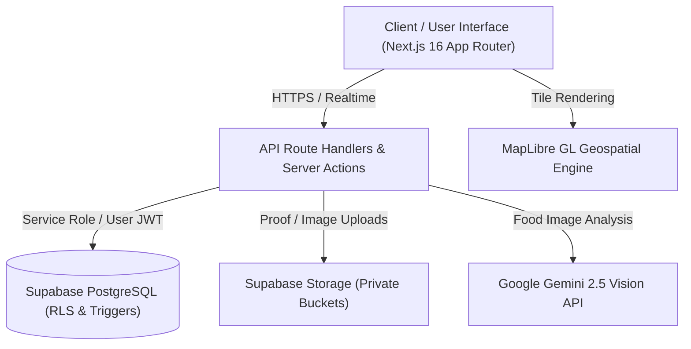

# FoodQueue — AI Food Waste Intelligence & Redistribution Platform

[](https://nextjs.org/)
[](https://react.dev/)
[](https://www.typescriptlang.org/)
[](https://supabase.com/)
[](https://tailwindcss.com/)
[](https://ai.google.dev/)
[](tests/)
[](LICENSE)

An institutional-grade, full-stack AI web platform that prevents commercial food waste at source through **deterministic demand forecasting**, automates surplus detection with **Google Gemini Multimodal Vision**, and guarantees safe, auditable chain-of-custody redistribution to verified community shelters and NGOs.

---

## 📌 Executive Summary

Institutional kitchens (corporate cafeterias, university dining halls, hospital canteens, and catering facilities) generate significant daily food waste due to unpredictable consumer turnout, over-preparation, and fragmented charity coordination. 

**FoodQueue closes this loop:**
1. **Before Cooking:** Predicts exact meal demand using historical turnouts and weekday trends to prevent over-production.
2. **After Service:** Audits plate waste and logs surplus within seconds using an AI camera scanner that classifies food safety tiers and remaining edible shelf-life.
3. **During Redistribution:** Deterministically pairs surplus with nearby verified receivers based on distance, capacity, diet requirements, and cold storage, managing end-to-end collection via PIN-verified digital handoffs.
4. **Impact Auditing:** Quantifies rescued food into verified metrics: meals saved, CO₂e greenhouse gas reduction, and financial savings.

---

## 🚀 Core MVP Capabilities

### 1. 🍳 Institutional Kitchen Intelligence
- **Deterministic Demand Forecasting (`mvp-baseline-v1`)**:
  - Implements a weighted 50/30/20 algorithm factoring same-weekday historical turnouts, 7-day trailing velocity, and baseline period averages.
  - Automatically handles zero-history cold-start scenarios, isolated measurement units, and dynamic confidence bounds `[0.20, 0.95]`.
- **Meal Planning & Production Scheduling**:
  - Interactive meal calendar tracking service times (Breakfast, Lunch, Dinner, Snacks), planned portion counts, and preparation statuses.
- **Consumption & Plate-Waste Audits**:
  - Enforces strict mass-balance validation: $\text{Leftover} = \text{Prepared} - \text{Consumed}$. Prevents phantom entries and calculates kitchen production efficiency in real time.
- **Multimodal AI Food Scanner (Google Gemini Vision)**:
  - Instant camera capture or image upload analyzes surplus food to extract:
    - Food category, freshness score, and estimated remaining shelf-life.
    - Safety Tier Assignment: **Tier 1 (Safe for immediate donation)**, **Tier 2 (Culinary repurposing / internal recovery)**, or **Tier 3 (Spoiled / Composting)**.
    - Packaging and safe storage handling guidelines.
- **Deterministic Food Recovery Decision Engine**:
  - Real-time decision tree that routes verified surplus to Immediate Redistribution, Internal Secondary Use, Animal Feed, or Organic Composting based on shelf-life and safety flags.
- **Live Food Rescue Clock**:
  - Dynamic countdown timer tracking safe consumption deadlines with real-time state transitions:
    - 🟢 **ACTIVE** ($> 60\text{ min remaining}$)
    - 🟡 **URGENT** ($\le 60\text{ min remaining}$ — triggers high-priority alerts)
    - 🔴 **EXPIRED** ($< 0\text{ min remaining}$ — automated diversion to disposal/composting)

---

### 2. 🤝 Smart Matching & Automated Redistribution
- **Deterministic Match Scoring Engine**:
  - Evaluates potential receivers in real time based on:
    - **Geographic Proximity**: Calculated via Haversine distance.
    - **Capacity Headroom**: Ensures surplus volume does not exceed receiver intake limits.
    - **Dietary & Category Compatibility**: Matches veg/non-veg, prepared meals, produce, and baked goods.
    - **Cold-Chain & Storage Suitability**: Verifies refrigeration capabilities when required.
    - **Time Window Feasibility**: Reconciles pickup windows with the surplus rescue clock.
- **Real-Time Supabase Event Broadcasting**:
  - Broadcasts new surplus opportunities instantly to eligible receiver dashboards without polling.

---

### 3. 🏢 Verified Receiver & Community Portal
- **Live Opportunity Feed**:
  - Real-time marketplace displaying nearby surplus opportunities, distance, food categories, expiry countdowns, and pickup instructions.
- **One-Click Acceptance & Allocation Locks**:
  - Concurrent acceptance guards prevent double-booking or fragmented batches.
- **Interactive Geospatial Map (MapLibre GL)**:
  - Vector map interface visualizing the kitchen source, receiving shelter, distance, and collection route.
- **Chain-of-Custody Handoff & Security**:
  - **4-Digit Verification PIN**: Generated on match acceptance and verified at handover.
  - **Digital Proof-of-Pickup**: Photo verification uploaded directly to private storage buckets.
  - **State Machine Integrity**: Irreversible transition flow: `requested` $\rightarrow$ `scheduled` $\rightarrow$ `picked_up`.

---

### 4. 📊 Real-Time Impact & Operational Analytics
- **Canonical Conversion Standards**:
  - **Social Impact**: $0.4\text{ kg} = 1\text{ Nutritious Meal}$.
  - **Environmental Impact**: $2.5\text{ kg CO}_2\text{e diverted per kg of food}$.
  - **Economic Recovery**: Financial valuation benchmarked at ₹60/kg ($0.72\text{ USD/kg}$).
- **Role-Aware Dashboards**:
  - **Kitchen View**: Tracks waste prevention rates, food loss reduction, and forecasting accuracy.
  - **Receiver View**: Measures meals distributed, community beneficiaries served, and historical pickup performance.
  - **Admin View**: Aggregates network-wide metrics, regional diversion stats, and top-performing organizations.

---

### 5. 🛡️ Administrative Governance & Security
- **Organization Verification Gate**:
  - Strict vetting pipeline for NGOs, food banks, and shelters before granting access to operational food lots.
- **Role-Based Access Control (RBAC)**:
  - Strict Row-Level Security (RLS) policies isolating data across Admins, Kitchen Managers, Kitchen Staff, and Receivers.
- **Full Traceability**:
  - Immutable audit logs for food items, verification events, handoff timestamps, and impact records.

---

## 🏗️ System Architecture & Tech Stack



| Layer | Technology | Purpose |
| :--- | :--- | :--- |
| **Framework** | **Next.js 16.4.0 (Turbopack)** | App Router, Server Components, Route Handlers |
| **Language** | **TypeScript 5.7 (Strict Mode)** | Full end-to-end type safety |
| **UI & Styling** | **Tailwind CSS 3.4 + Lucide React** | Dark-theme design system, micro-animations |
| **Database & Auth** | **Supabase (PostgreSQL 15+)** | Auth, Row-Level Security (RLS), Realtime Broadcasts |
| **AI Intelligence** | **Google Gemini 2.5 (`@google/genai`)** | Multimodal food classification & shelf-life estimation |
| **Maps & Routing** | **MapLibre GL 6.13** | Interactive geospatial dispatch & routing visualizer |
| **Validation** | **Zod 3.24** | Runtime schema contracts on all API and form boundaries |
| **Testing** | **Node.js Test Runner + tsx** | 179 automated unit, integration, and security tests |

---

## 📂 Repository Structure

```
FoodQueue/
├── app/
│   ├── (auth)/                # Authentication: Login, Register, Error, Callback
│   ├── admin/                 # Admin: Analytics, Organization approvals, User roles
│   ├── api/                   # 28 REST API endpoints (Envelopes: { data, error })
│   │   ├── admin/             # Verification, User assignment, Organizations
│   │   ├── ai/                # Gemini food classification
│   │   ├── analytics/         # Kitchen, Receiver, and Network impact metrics
│   │   ├── matching/          # Deterministic pairing, acceptance, rejection
│   │   ├── meals/             # Meal planning & scheduling
│   │   ├── pickups/           # Handoff, PIN verification, proof upload
│   │   ├── predictions/       # Demand forecasting engine
│   │   ├── receiver/          # Opportunities feed & claiming
│   │   └── surplus/           # Surplus registration & handoffs
│   ├── kitchen/               # Kitchen Portal: Meals, Surplus, Audits, Analytics
│   ├── receiver/              # Receiver Portal: Opportunities, Pickups, Impact
│   ├── layout.tsx             # Root layout with brand theme & metadata
│   └── page.tsx               # Public landing page with role-based routing
├── components/
│   ├── admin/                 # Admin verification tables & stat widgets
│   ├── brand/                 # Official FoodQueue SVG marks & logo badges
│   ├── dashboard/             # Navigation bars, role-aware headers, status indicators
│   ├── kitchen/               # AI Classify Modal, Rescue Clock, Prediction Card
│   ├── receiver/              # Opportunity Cards, Pickup State Badges
│   └── shared/                # MapLibre MapView, Modal wrappers, Realtime alerts
├── lib/
│   ├── ai/                    # Gemini 2.5 Vision client & prompt engineering
│   ├── analytics/             # Impact conversions (CO2e, Meals, ₹ Economic value)
│   ├── rules/                 # Pickup state machine & transition authorization
│   ├── supabase/              # Server, Browser, and Admin Supabase clients
│   └── validation/            # Zod validation schemas for all entities
├── docs/                      # Architecture, Database Rules, API Spec, Final Audit
├── scripts/
│   └── seed-demo-data.ts      # Deterministic demo dataset seeding script
├── supabase/
│   ├── migrations/            # Versioned SQL migrations with RLS policies
│   └── seed.sql               # Baseline database fixtures
├── tests/                     # 179 automated test suites
├── start.bat                  # One-click Windows development launcher
├── close.bat                  # One-click Windows server cleanup utility
└── package.json
```

---

## ⚡ Getting Started

### Prerequisites
- **Node.js**: v18.18.0+ or v20+ (tested on v24.16.0)
- **npm**: v10+ (tested on v11.13.0)
- **Supabase Account**: A PostgreSQL instance with migrations applied
- **Google Gemini API Key**: For multimodal AI food classification

---

### 1. Installation

Clone the repository and install dependencies:
```bash
git clone https://github.com/yashwanthdqc2007-cell/FoodQueue.git
cd FoodQueue
npm install
```

---

### 2. Environment Configuration

Create a `.env.local` file in the project root:
```env
NEXT_PUBLIC_SUPABASE_URL=https://your-project.supabase.co
NEXT_PUBLIC_SUPABASE_PUBLISHABLE_KEY=your-supabase-publishable-key
SUPABASE_SECRET_KEY=your-supabase-service-role-key
GEMINI_API_KEY=your-google-gemini-api-key
NEXT_PUBLIC_MAP_STYLE_URL=https://demotiles.maplibre.org/style.json
```

---

### 3. Database Migration & Demo Data Seeding

Apply database schema migrations and run the deterministic seed script:
```bash
# Seed deterministic test kitchen, receiver NGOs, meals, surplus, and pickup records
npm run seed
```

---

### 4. Running the Application

#### Option A: One-Click Windows Launcher
Double-click `start.bat` or run:
```cmd
start.bat
```
*(Automatically checks port 3000, starts the server in background, waits for health check, and launches your default browser).*

To stop all FoodQueue services:
```cmd
close.bat
```

#### Option B: Standard CLI
```bash
npm run dev
```
Open [http://localhost:3000](http://localhost:3000) in your browser.

---

## 🧪 Quality Assurance & Test Verification

FoodQueue includes a comprehensive, multi-phase automated test suite verifying business logic, role security, math invariants, and state machines.

```bash
# Run the complete test suite (179 tests across 62 suites)
npm test

# Run TypeScript static typecheck
npm run typecheck

# Run Next.js & ESLint linter
npm run lint

# Build for production
npm run build
```

### Test Suite Summary
| Suite Category | Coverage | Status |
| :--- | :--- | :---: |
| **Deterministic Demand Prediction** | 50/30/20 weights, cold-start fallback, confidence bounds | ✅ Passed |
| **Surplus AI Validation Schemas** | Gemini payload contracts, confidence clamping, category enum | ✅ Passed |
| **Food Rescue Clock Engine** | Active / Urgent / Expired bounds, null safety, date handling | ✅ Passed |
| **Food Recovery Decision Engine** | Redistribution, culinary recovery, animal feed, composting | ✅ Passed |
| **Pickup State Machine & Security** | Irreversible terminal states, role authorization, proof validation | ✅ Passed |
| **Receiver Verification & Intake** | Proximity bounds, capacity ceilings, dietary suitability | ✅ Passed |
| **Impact Conversion & Math Invariants** | $0.4\text{ kg/meal}$, $2.5\text{ kg CO}_2\text{e/kg}$, mass-balance audits | ✅ Passed |
| **Portal Context & RBAC Rules** | Unassigned org guards, admin inspection mode, role isolation | ✅ Passed |
| **Total Test Results** | **179 passing / 0 failing / 0 skipped** | **100% PASS** |

---

## 🔑 Demo Accounts & Pre-Configured Roles

Once seeded via `npm run seed`, the following operational personas can be tested:

| Persona | Role | Default Email | Portal Access |
| :--- | :--- | :--- | :--- |
| **Kitchen Executive** | `kitchen_manager` | `kitchen@foodqueue.org` | `/kitchen` (Forecasting, Meals, Surplus, Audits) |
| **Food Bank Coordinator** | `receiver_staff` | `hope.receiver@foodqueue.org` | `/receiver` (Opportunities, Pickups, Proof Upload) |
| **Network Administrator** | `admin` | `admin@foodqueue.org` | `/admin` (Auditing, Approvals, System Analytics) |

---

## 📖 Detailed Documentation

- **[Master Architecture](ARCHITECTURE.md)**: System design, entity relationships, security principles, and product workflows.
- **[Database Rules & Schema Contract](DATABASE_RULES.md)**: PostgreSQL schema definitions, enum types, triggers, and Row-Level Security (RLS) rules.
- **[API Specification](API_SPEC.md)**: Request/response envelopes, query parameters, error contracts, and Zod schemas.
- **[Final Acceptance Audit](docs/final-acceptance-audit.md)**: Complete audit report verifying all 9 engineering phases against production criteria.
- **[Supabase Setup Guide](docs/SUPABASE_SETUP.md)**: Step-by-step setup for PostgreSQL storage buckets, auth triggers, and remote deployments.

---

## 📄 License

Distributed under the MIT License. See [LICENSE](LICENSE) for more information.

---

<div align="center">
  <b>FoodQueue</b> — <i>Good food deserves a second chance.</i>
</div>
