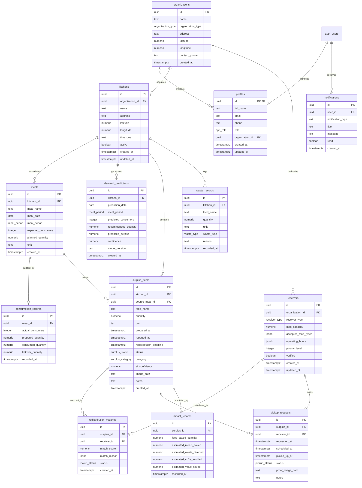
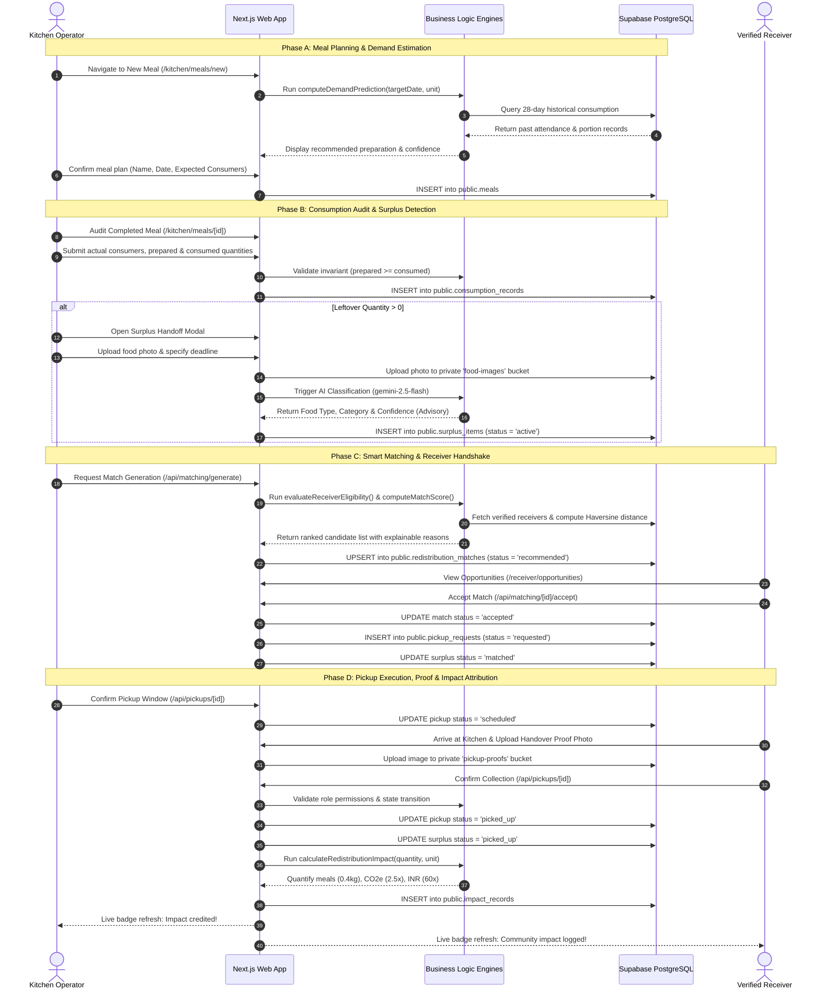
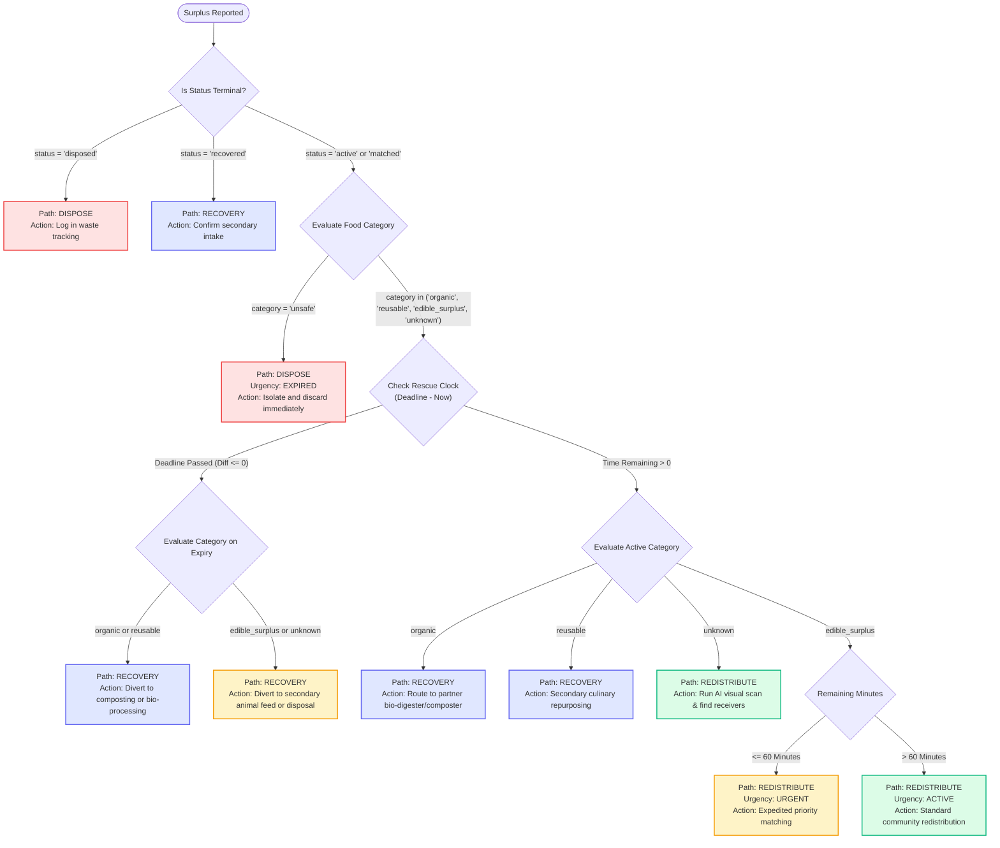
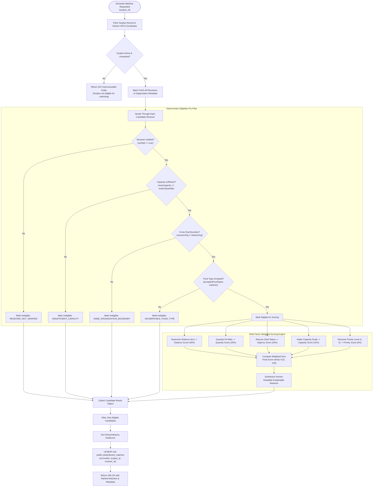

# FoodQueue — Workflows, Process Maps & Technical Diagrams

This document collects the complete architectural and operational diagrams for the **FoodQueue** platform. All diagrams use GitHub-flavored Mermaid syntax and are followed by detailed, plain-language walkthroughs of data flows, state machines, and edge cases.

---

## 1. System Architecture Diagram

```mermaid
graph TB
    subgraph Client_Layer ["Client Layer (Browser)"]
        UI_Kitchen["Kitchen Dashboard (/kitchen)"]
        UI_Receiver["Receiver Portal (/receiver)"]
        UI_Admin["Admin Center (/admin)"]
        UI_Shared["Shared Components (MapView, RealtimeBadge)"]
    end

    subgraph App_Server_Layer ["Application & Server Layer (Next.js 16 + Turbopack)"]
        Proxy["Proxy / Middleware (proxy.ts)"]
        AuthRoutes["Auth Handlers (/auth/*)"]
        
        subgraph Route_Handlers ["Next.js Route Handlers (/api/*)"]
            API_Meals["Meal & Consumption APIs"]
            API_Predict["Demand Prediction API"]
            API_Surplus["Surplus & AI APIs"]
            API_Match["Matching Engine APIs"]
            API_Pickup["Pickup & Proof APIs"]
            API_Analytics["Analytics APIs (Kitchen/Receiver/Admin)"]
            API_Admin["Admin Governance APIs"]
        end

        subgraph Core_Engines ["Deterministic Business Logic Engines"]
            Engine_Pred["Prediction Baseline (mvp-baseline-v1)"]
            Engine_AI["AI Classification & Normalizer"]
            Engine_Rules["Recovery & Rescue Clock Engines"]
            Engine_Match["Haversine & Scoring Engine"]
            Engine_State["Pickup State Machine"]
            Engine_Impact["Impact Calculator (0.4 kg/meal)"]
        end
    end

    subgraph Platform_Data_Layer ["Platform & Data Layer (Supabase Cloud)"]
        Supa_Auth["Supabase Auth (JWT / Sessions)"]
        Supa_PG["PostgreSQL Database (12 Tables, RLS Enabled)"]
        Supa_Realtime["Supabase Realtime (WebSocket Publication)"]
        
        subgraph Storage_Buckets ["Private Storage Buckets (Signed URLs)"]
            Bucket_Food["food-images (Max 5MB)"]
            Bucket_Proofs["pickup-proofs (Max 5MB)"]
        end
    end

    subgraph External_Services ["External Cloud Services"]
        Gemini_API["Google Gemini 2.5 Flash (Vision API)"]
        OpenFreeMap["OpenFreeMap / MapLibre Tile Server"]
    end

    %% Client to Server Connections
    UI_Kitchen -->|HTTP / JSON| Proxy
    UI_Receiver -->|HTTP / JSON| Proxy
    UI_Admin -->|HTTP / JSON| Proxy
    Proxy --> Route_Handlers
    UI_Shared -->|Vector Tiles| OpenFreeMap
    UI_Shared -->|WebSocket Listen| Supa_Realtime

    %% Server Internal Wiring
    API_Meals --> Engine_Pred
    API_Surplus --> Engine_AI
    API_Surplus --> Engine_Rules
    API_Match --> Engine_Match
    API_Pickup --> Engine_State
    API_Pickup --> Engine_Impact

    %% Server to External Services
    Engine_AI -->|Base64 Image + Prompt| Gemini_API

    %% Server to Supabase
    Route_Handlers -->|Server Client (Cookie Auth)| Supa_Auth
    Route_Handlers -->|RLS Authenticated Client| Supa_PG
    API_Admin -->|Service Role Client| Supa_PG
    API_Surplus -->|Read / Write| Bucket_Food
    API_Pickup -->|Read / Write| Bucket_Proofs
    Supa_PG -.->|Postgres Changes| Supa_Realtime
```

### Architecture Walkthrough
1. **Client Layer**: Pure React 19 Client and Server Components styled with Tailwind CSS. Navigation bars instantiate the `useRealtimeSync` hook to maintain live operational synchronization.
2. **Application Server Layer**: Hosted on Next.js 16 with Turbopack. Incoming HTTP requests pass through `proxy.ts` (the Next.js 16 session proxy) before reaching Route Handlers. All request payloads are strictly validated using Zod schemas.
3. **Core Engines**: Reusable, pure-function mathematical engines executing deterministic calculations (prediction baseline, distance, eligibility, scoring, impact).
4. **Data Layer**: Supabase PostgreSQL enforcing Row-Level Security (RLS) on all 12 tables. Multi-tenant access is filtered at the database engine level using security-definer helper functions.
5. **Storage Layer**: Two dedicated private buckets (`food-images`, `pickup-proofs`) accessible only via time-limited 3600-second signed URLs.
6. **External Integrations**: Google Gemini API invoked exclusively server-side via `@google/genai` (secret key never leaks to client); MapLibre GL connects directly to OpenFreeMap vector tile servers.

---

## 2. Entity-Relationship (ER) Diagram



### Data Model Rules & Integrity Constraints
- **Multi-Tenant Scoping**: All operational tables (`meals`, `kitchens`, `surplus_items`, `receivers`) cascade from `organizations`.
- **Primary & Foreign Keys**: Standardized UUID primary keys (`gen_random_uuid()`).
- **Check Constraints**: Non-negative consumer numbers (`check (expected_consumers >= 0)`), strictly positive surplus quantities (`check (quantity > 0)`), confidence clamped between 0 and 1, match scores between 0 and 100.
- **Unique Match Constraint**: `unique (surplus_id, receiver_id)` on `redistribution_matches` guarantees no duplicate ranking records are inserted per candidate pair.
- **Idempotent Impact Link**: `impact_records` maintains a 1-to-1 relationship with `surplus_items` via `surplus_id` uniqueness guards in the API handler.

---

## 3. End-to-End Kitchen Meal Planning to Redistribution Lifecycle



---

## 4. Surplus Intelligence & Recovery Decision Tree



---

## 5. Smart Redistribution Matching Flow



---

## 6. Pickup Lifecycle State Machine

```mermaid
stateDiagram-v2
    [*] --> requested : Receiver or Kitchen accepts match

    state "requested" as requested {
        description : Pickup initiated; awaiting collection window confirmation.
    }

    state "scheduled" as scheduled {
        description : Collection window confirmed by Kitchen or Admin.
    }

    state "picked_up (TERMINAL)" as picked_up {
        description : Food collected; proof photo stored; impact records created.
    }

    state "cancelled (TERMINAL)" as cancelled {
        description : Pickup aborted by either party or admin.
    }

    requested --> scheduled : Kitchen or Admin confirms (scheduledAt)
    requested --> picked_up : Direct Handover (Receiver or Admin)
    requested --> cancelled : Kitchen, Receiver, or Admin aborts

    scheduled --> picked_up : Standard Collection (Receiver confirms with proof)
    scheduled --> cancelled : Kitchen, Receiver, or Admin aborts

    picked_up --> [*]
    cancelled --> [*]

    note right of picked_up
        TERMINAL STATE:
        - Surplus status becomes 'picked_up'
        - impact_records row inserted
        - Further modifications return 409 Conflict
    end note

    note right of cancelled
        TERMINAL STATE:
        - Surplus released back or marked inactive
        - Further modifications return 409 Conflict
    end note
```

### Transition & Authorization Matrix
| Current State | Target State | Permitted Roles | Side Effects |
| :--- | :--- | :--- | :--- |
| `requested` | `scheduled` | `kitchen`, `admin` | Sets `scheduled_at` timestamp; surplus transitions to `pickup_pending`. |
| `requested` | `picked_up` | `receiver`, `admin` | Sets `picked_up_at`; links `proof_image_path`; computes and inserts `impact_records`. |
| `scheduled` | `picked_up` | `receiver`, `admin` | Sets `picked_up_at`; links `proof_image_path`; computes and inserts `impact_records`. |
| `requested` | `cancelled` | `kitchen`, `receiver`, `admin` | Records cancellation reason in notes; terminates transaction. |
| `scheduled` | `cancelled` | `kitchen`, `receiver`, `admin` | Aborts scheduled handover; terminates transaction. |
| `picked_up` | *Any* | **None** | **Strictly Forbidden (409 Conflict)**; state is locked and auditable. |
| `cancelled` | *Any* | **None** | **Strictly Forbidden (409 Conflict)**; aborted transaction cannot be revived. |

---

## 7. Realtime Synchronization & Fallback Polling Loop

```mermaid
sequenceDiagram
    autonumber
    actor User as Dashboard User
    participant Hook as useRealtimeSync Hook
    participant SupaRT as Supabase Realtime Channel
    participant SupaAPI as Next.js API Routes

    User->>Hook: Mount Page (e.g. /kitchen or /receiver)
    Hook->>Hook: Set status = 'connecting'
    Hook->>SupaRT: channel('dashboard-sync').on('postgres_changes', '*').subscribe()
    
    alt WebSocket Connected Successfully
        SupaRT-->>Hook: Event: 'SUBSCRIBED'
        Hook->>Hook: Set status = 'connected' (Green Badge)
    else WebSocket Fails or Firewalled
        SupaRT-->>Hook: Event: 'CHANNEL_ERROR' or 'TIMED_OUT'
        Hook->>Hook: Set status = 'polling' (Amber Badge)
        Hook->>Hook: Initialize setInterval(pollingInterval = 20,000ms)
    end

    Note over Hook, SupaAPI: Normal Operation — Realtime Event Burst
    SupaRT-->>Hook: Postgres UPDATE on 'pickup_requests'
    SupaRT-->>Hook: Postgres INSERT on 'impact_records'
    Note over Hook: Debounce Timer Activated (400ms window)
    Hook->>Hook: Coalesce rapid events; reset timer
    Hook->>SupaAPI: Trigger single authoritative onUpdate() re-fetch
    SupaAPI-->>Hook: Return fresh datasets
    Hook-->>User: Re-render UI components with updated state

    Note over Hook, SupaAPI: Fallback Operation — Periodic Polling Loop
    loop Every 20 Seconds
        Hook->>SupaAPI: Fallback polling tick -> execute onUpdate()
        SupaAPI-->>Hook: Return latest data
        Hook-->>User: Refresh UI transparently
    end
```

---

*Diagrams generated and verified against active system schemas, route handlers, state machines, and component trees.*
